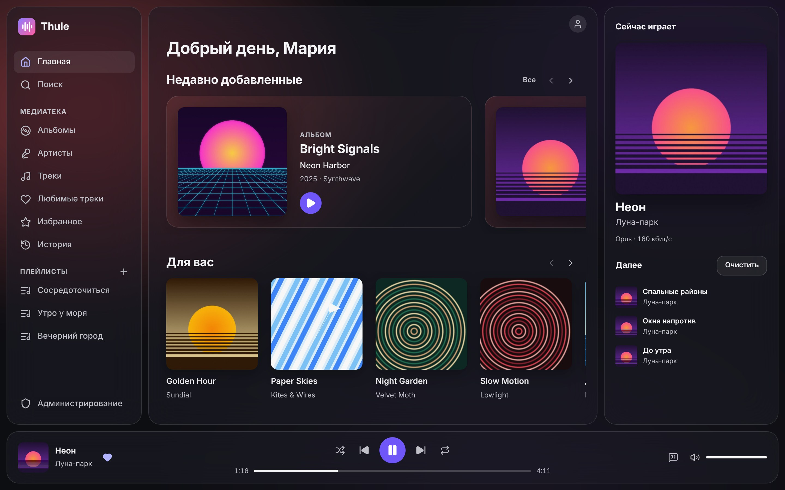
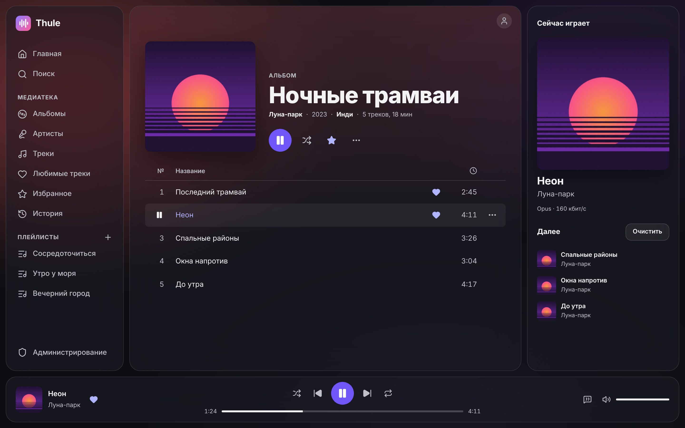
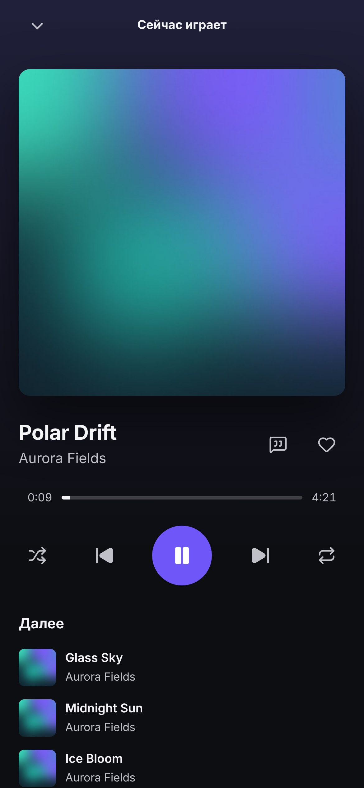

  

<h1 align="center">Thule</h1>

  Свой музыкальный стриминг: ваша коллекция, ваш сервер, красивый плеер в браузере.

Thule превращает папку с музыкой в стриминговый сервис. Поставьте его на домашний сервер или NAS — и слушайте свою коллекцию в браузере на компьютере и телефоне, как в привычных музыкальных приложениях. Без подписок, рекламы и чужого каталога: только ваша музыка.

## Что умеет

- **Медиатека собирается сама.** Альбомы, артисты, обложки и тексты песен подхватываются прямо из файлов: MP3, FLAC, Ogg, Opus, M4A и других. Новые альбомы можно загрузить из браузера — целыми папками.
- **Всё, к чему привыкли.** Главная с новинками и подборкой «Для вас», любимые треки, избранные альбомы и артисты, плейлисты, история прослушиваний, тексты песен и поиск, который прощает опечатки.
- **Звучит как надо.** Дома — оригинал без потерь, в дороге — облегчённое качество, чтобы не тратить трафик. Музыкой можно управлять с экрана блокировки и медиакнопками.
- **Красиво.** Матовое стекло и мягкий фон, который подстраивается под обложку играющего трека. Акцентный цвет — на ваш вкус, размытие можно выключить.
- **На компьютере и на телефоне.** У телефона своя раскладка: мини-плеер над вкладками и полноэкранный плеер.
- **Для всей семьи.** У каждого свой аккаунт со своими лайками, плейлистами и настройками, а администратор следит за медиатекой и пользователями. Чужой текст песни или неудачную обложку он поправит прямо из меню трека или альбома.
- **На русском и английском.**

  
  &nbsp;
  

## Установка

Thule ставится одной командой через Docker. Как это сделать, подключить HTTPS и делать резервные копии — в [инструкции по установке](docs/deploy.md).

---

Для разработчиков: [как всё устроено](docs/architecture.md) · [разработка и тесты](docs/development.md) · [история работ](docs/roadmap.md)
